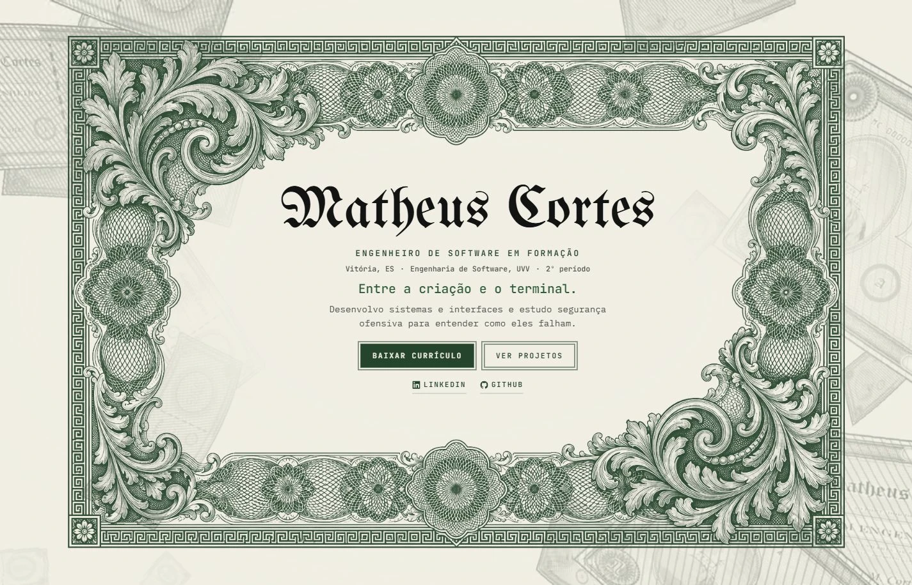

# Portfólio — Matheus Cortes

Portfólio pessoal de Matheus Cortes, estudante de Engenharia de Software na UVV, com foco em desenvolvimento web e cibersegurança. O site reúne projetos com estudo de caso, certificações, write-ups de segurança e a atividade pública no GitHub, em português e em inglês.



## Tecnologias

- Next.js 16.4.2 e React 19.3.1
- TypeScript 6.0.3
- CSS próprio, sem framework de componentes
- Lenis 1.3.27 para a rolagem
- Vitest 5.0.5 para os testes
- Animações modeladas e renderizadas no Blender 5.2

## O que o site faz

- Projetos com filtro por categoria; cada um abre um estudo de caso com o que eu fiz, o desafio, o resultado e o que eu faria diferente
- Versões em português (`/`) e em inglês (`/en`)
- Acessibilidade: abas no padrão WAI-ARIA, menu e modal em `<dialog>`, link para pular ao conteúdo e texto alternativo nas capturas; animações desligadas com `prefers-reduced-motion`
- Busca: metadados, Open Graph, JSON-LD (`ProfilePage` e `Person`), `sitemap.xml`, `robots.txt`, `llms.txt` e `llms-full.txt`
- Segurança: Content Security Policy e cabeçalhos no `next.config.ts`, proxy que recusa raspadores conhecidos e nenhum segredo no repositório
- Formulário de contato pelo Web3Forms

## Como rodar

Requer Node.js.

```bash
npm install
npm run dev      # http://localhost:3000
npm test         # testes
npm run lint     # ESLint
npm run build    # build de produção
npm run start    # serve o build
```

Para o formulário de contato entregar as mensagens, crie um `.env.local` com a chave do Web3Forms:

```bash
NEXT_PUBLIC_WEB3FORMS_KEY=sua-chave
```

## Estrutura

```
src/
├── app/            rotas (pt e en), robots, sitemap, llms.txt e estilos
├── componentes/    página, navegação, estudo de caso e animações
├── conteudo/       textos, projetos, certificações e tecnologias
└── lib/            regras puras: SEO, rolagem, idioma, contato, animações
```

Cada comportamento tem um critério de aceite com identificador (`EST-01`, `EST-02`…), e o teste correspondente leva o mesmo identificador no nome.

## Direitos

© 2026 Matheus Cortes. Todos os direitos reservados.

O código está público para consulta. Reutilizar, copiar ou redistribuir o código, os textos, a identidade visual, as imagens ou as animações exige autorização. As capturas de projetos de clientes pertencem aos respectivos titulares; as gravuras antigas usadas como base estão em domínio público.
