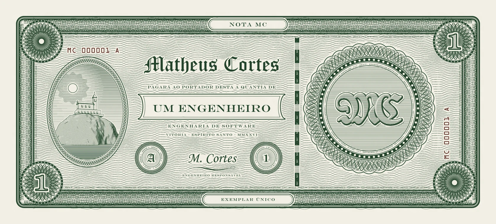
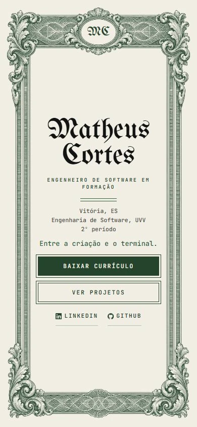
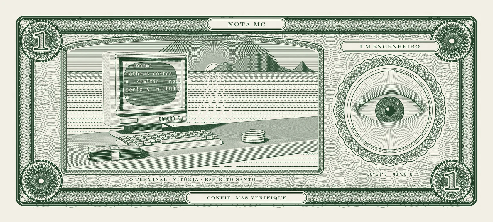

<div align="center">



<br>

<sub><code>SÉRIE A</code> &nbsp;·&nbsp; <code>MC 000001 A</code> &nbsp;·&nbsp; <code>VITÓRIA · ESPÍRITO SANTO · MMXXVI</code></sub>

# Matheus Cortes

**Portfólio pessoal** &nbsp;·&nbsp; Engenharia de Software (UVV) &nbsp;·&nbsp; Cibersegurança

<br>


</div>

<br>

> **Pagará ao portador desta a quantia de um engenheiro.**
>
> Este site é uma cédula: papel cor de marfim, tinta verde de talho-doce, guilhoché, títulos góticos e números de série.
> Cada seção é uma parte do documento, e cada projeto abre como um estudo de caso.

<br>

## ✦ A cédula por dentro

<table>
<tr>
<td width="68%"></td>
<td width="32%"></td>
</tr>
</table>

| | Seção | O que tem |
|:-:|---|---|
| **I** | Abertura | Nome, frase que se decifra como um número de série e currículo para baixar |
| **II** | Registro do cofre | Ficha de entrada do visitante, montada no próprio navegador e sem gravar nada |
| **III** | Projetos | 15 trabalhos com filtro por categoria; cada um abre um estudo de caso com o que eu fiz, o desafio, o resultado e o que eu faria diferente |
| **IV** | Sobre | Ficha "Quem sou", autenticada por um selo MC gravado na hora |
| **V** | Certificações | Emissor, categoria, descrição e competências de cada uma |
| **VI** | Write-ups | Análises de segurança escritas como relatório |
| **VII** | Atividade | Contribuições públicas do perfil no GitHub |
| **VIII** | Contato | Formulário que entrega a mensagem por e-mail |

<br>

## ✦ Detalhes de impressão

<table>
<tr>
<td valign="top" width="50%">

**Movimento**
- Animações próprias em gravura, modeladas e renderizadas no Blender
- Cada uma toca quando aparece e repete a cada nova passagem
- Rolagem suave com Lenis e entradas escalonadas
- Tudo desligado com `prefers-reduced-motion`

**Acessibilidade**
- Abas do estudo de caso no padrão da WAI-ARIA (setas, Home e End)
- Menu e modal em `<dialog>`, com o foco devolvido ao fechar
- Link para pular ao conteúdo e textos alternativos em todas as capturas

</td>
<td valign="top" width="50%">

**Busca e IA**
- Metadados, Open Graph e JSON-LD (`ProfilePage` e `Person`)
- `sitemap.xml`, `robots.txt`, `llms.txt` e `llms-full.txt`
- Versões em português (`/`) e em inglês (`/en`)

**Segurança**
- Content Security Policy e cabeçalhos de segurança no `next.config.ts`
- Proxy que recusa raspadores conhecidos e libera robôs de busca
- Nenhum segredo no repositório: a chave do formulário fica no `.env.local`

</td>
</tr>
</table>

<br>

## ✦ Estrutura

```
src/
├── app/            rotas em dois idiomas, robots, sitemap, llms.txt e estilos
├── componentes/    página, navegação, modal do estudo de caso e animações
├── conteudo/       textos, projetos, certificações e tecnologias (pt e en)
└── lib/            regras puras: SEO, rolagem, idioma, contato, bloqueio, animações
```

Os comportamentos seguem critérios de aceite com identificador (`EST-01`, `EST-02`…), e os testes levam o mesmo identificador no nome.

<br>

## ✦ Como rodar

```bash
npm install
npm run dev      # http://localhost:3000
npm test         # testes (Vitest)
npm run lint     # ESLint
npm run build    # build de produção
npm run start    # serve o build
```

O formulário de contato usa o Web3Forms. Para receber as mensagens, crie um `.env.local` com:

```bash
NEXT_PUBLIC_WEB3FORMS_KEY=sua-chave
```

<br>

<div align="center">



<sub><b>CONFIE, MAS VERIFIQUE</b></sub>

</div>

<br>

## ✦ Direitos

© 2026 Matheus Cortes. Todos os direitos reservados.

O código está público para consulta e avaliação. Reutilização, cópia ou redistribuição, total ou parcial, do código, dos textos, da identidade visual, das imagens e das animações exigem autorização. As capturas de projetos de clientes pertencem aos respectivos titulares, e as gravuras antigas usadas como base estão em domínio público.
